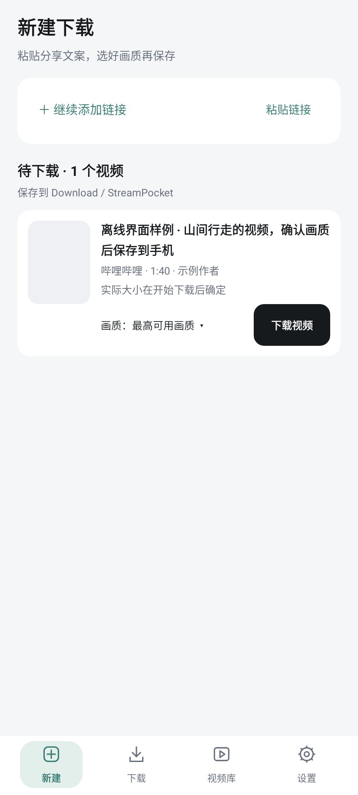
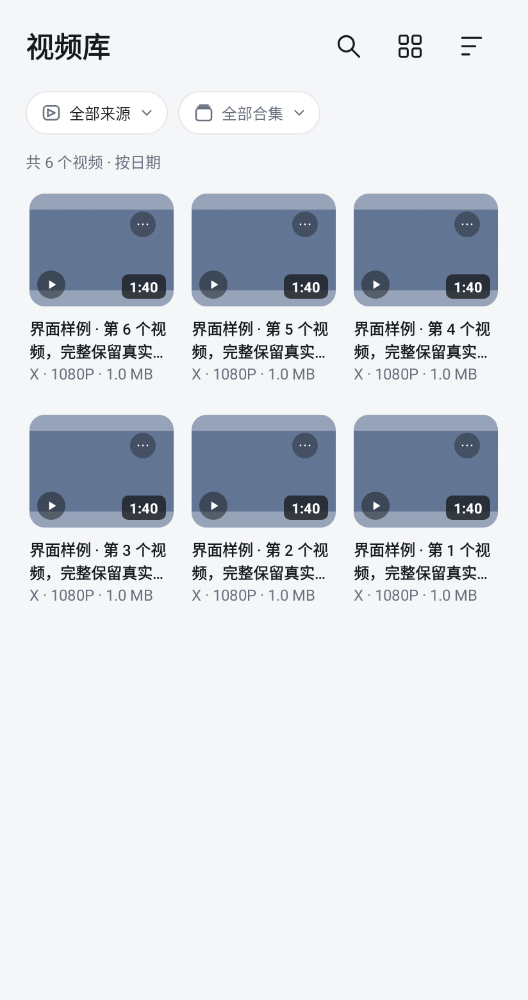
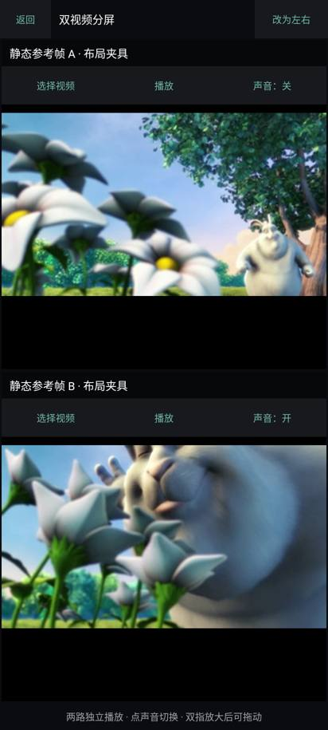

# StreamPocket · 拾流

**An open-source Android video downloader, local video player, and lightweight video editor.**

[Download APK](https://github.com/wozhenbang2004/StreamPocket/releases/latest/download/StreamPocket-arm64-v8a.apk) · [Releases](https://github.com/wozhenbang2004/StreamPocket/releases) · [简体中文](README.md)

Save videos from YouTube, X / Twitter, Bilibili, and Douyin, then watch, organize, bookmark, and trim them on your phone. Paste a link, choose an available quality, and add it to the download queue.

Android 7.0+ · ARM64 · No ads · No StreamPocket account required

## From a link to your library

1. Paste a video URL or share text. Multiple links are supported.
2. Parse the links, choose a quality, and confirm the downloads.
3. Open completed videos in the library to watch, organize, or edit them.

Failed links stay available for retry. Unfinished work and selected qualities are saved so you can return later.

## Features

| Task | What StreamPocket offers |
| --- | --- |
| Download videos | Share-link recognition, quality selection, batch queues, pause/resume, retries, and automatic audio/video merging |
| Organize your collection | Two-column, three-column, and list layouts; source filters, search, collections, and saved playback positions |
| Watch locally | Swipe between videos, pinch to zoom, playback speed controls, and two-video split playback with selectable audio |
| Keep useful moments | Named timestamps and clip markers that you can revisit or send to the editor |
| Make a short collection | Trim and arrange clips, export a new video, and keep the original files and editing draft |
| Manage accounts | Optional website sign-in or login-file import, with per-platform enable/disable and removal |

## Supported sites

| Site | Scope |
| --- | --- |
| **YouTube** | Standard video URLs, `youtu.be` links, and Shorts. A video URL with playlist context downloads the selected video only |
| **X / Twitter** | Video posts, including multiple videos in one post. Some content requires account access |
| **Bilibili** | Video pages and `b23.tv` share links. Available qualities depend on the video and account permissions |
| **Douyin** | Video pages and share links. Support is experimental; some links may fail |
| **Other sites** | Additional extraction is provided by yt-dlp; individual sites and URLs are not guaranteed to work |

**YouTube support does not mean every video can be downloaded.** Public videos can often be attempted without signing in. Age-restricted, private, or members-only videos require the corresponding account access, and signing in still does not guarantee a successful download. Website verification, region restrictions, and network conditions may also apply. Whole channels, entire playlists, and ongoing livestreams are not supported.

## Screenshots

<table>
  <tr>
    <td></td>
    <td></td>
    <td></td>
  </tr>
  <tr><td>Choose a quality</td><td>Organize local videos</td><td>Play two videos</td></tr>
</table>

Previews use sample content. Some labels may differ from the latest version.

## Install and update

Download `StreamPocket-arm64-v8a.apk` from the [latest release](https://github.com/wozhenbang2004/StreamPocket/releases/latest), then open it on your Android phone.

If StreamPocket is already installed, install the new APK over it; **do not uninstall first**. You can also use **Settings → Advanced & About → App updates → Check for updates**. Your videos, accounts, download history, and drafts are retained. The current app interface is in Chinese.

Completed videos are saved to `Download / StreamPocket`. Your phone must be able to reach the original video website.

## Privacy and accounts

Media is processed on your phone without a third-party parsing server. Login data is encrypted locally and used to access the selected websites. You can disable or remove saved login data at any time. Do not share exported login files.

Download only content you have permission to save and follow the source platform's terms.

## Development and contributions

Bug reports, usability feedback, and pull requests are welcome. For download issues, include the platform, reproduction steps, and error message. Do not upload login files or private videos.

Requirements: JDK 17, Python 3.9+, Android SDK 35, and Build Tools 35.0.0. The project uses Gradle 8.9 and AGP 8.7.3.

```bash
# Linux / macOS
chmod +x gradlew
./gradlew assembleDebug
./gradlew testDebugUnitTest lintDebug
```

On Windows, use `gradlew.bat assembleDebug`. The debug APK is written to `app/build/outputs/apk/debug/app-debug.apk`. A build signed with your own key cannot replace an installed release signed with a different key. The launcher downloads and verifies the pinned Gradle distribution.

[Testing](docs/TESTING.md) · [Download behavior](docs/DOWNLOAD_FLOW.md) · [Playback and editing](docs/MEDIA_EXPERIENCE.md) · [Earlier changes](docs/CHANGELOG.md)

## License

StreamPocket's own code is licensed under [GPL-3.0-or-later](LICENSE). Video extraction uses yt-dlp; media processing uses FFmpeg and other open-source components. See [third-party notices](THIRD_PARTY_NOTICES.md) for licenses and attribution, and [corresponding sources](docs/THIRD_PARTY_SOURCES.md) for source and build information.
