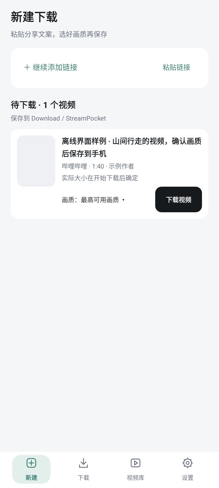
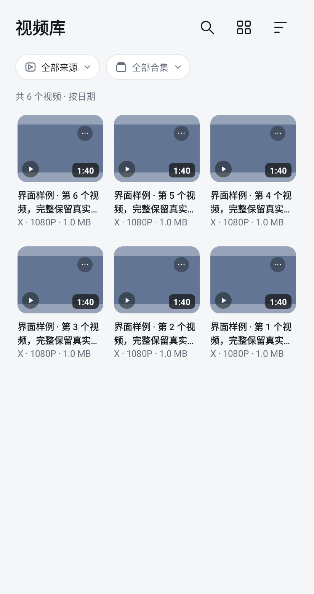
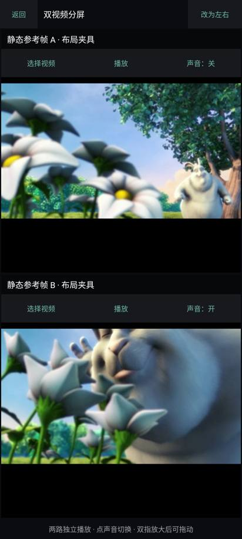

# 拾流 StreamPocket

**开源 Android 视频下载器、本地播放器与轻剪辑工具。**

An open-source Android video downloader, local video player, and lightweight video editor.

[下载安装包](https://github.com/wozhenbang2004/StreamPocket/releases/latest/download/StreamPocket-arm64-v8a.apk) · [版本记录](https://github.com/wozhenbang2004/StreamPocket/releases) · [English](README.en.md)

把网上的视频链接，变成手机里随时能看的收藏。复制链接、选择画质、下载，再用拾流播放、整理、标记和剪辑。

Android 7.0 及以上 · ARM64 · 无广告 · 无需注册拾流账号

**0.5.0 开发预览**：这一分支加入整队与批量下载管理、观看状态与收藏筛选，以及画中画、播放模式和音轨/字幕选择。正式发行仍为 0.4.1；预览构建与验证入口见 [PR #1](https://github.com/wozhenbang2004/StreamPocket/pull/1)。

## 从一条链接开始

1. 复制视频链接，在拾流粘贴；也可以一次粘贴多条分享文案。
2. 解析后选择画质，加入下载队列。
3. 下载完成后，在视频库播放、归类或剪辑。

失败的链接会保留，可以重新解析；需要账号权限时，可点“登录并重试”进入对应平台的官方登录或导入入口，保存后重试原任务。离开应用后也能回来继续处理。

## 下载、播放、整理，一处完成

| 想做什么 | 拾流能做什么 |
| --- | --- |
| 保存网上的视频 | 识别分享链接，选择源站提供的画质；支持整队暂停/继续、等待顺序调整与多选管理，分离的音视频自动合并 |
| 只留下声音 | 解析后可选择 MP3 或 M4A；音频保存在同一下载目录，可从下载记录打开或分享 |
| 保存图集与附件 | 小红书、抖音图集试用，按帖子保存为 ZIP；视频可选保存源站可用的字幕和封面 |
| 挑选合集内容 | 显式展开 YouTube 播放列表或 B站分P的前 100 项，勾选后解析；支持批量画质设置 |
| 找到下载的内容 | 双列、三列或列表浏览；观看状态、收藏、来源、名称和合集可组合筛选；合集支持改名和批量整理 |
| 舒服地看视频 | 上下滑动、缩放、倍速；画中画、单次/单个循环/连续播放、已有音轨和内嵌字幕选择；保留双视频分屏 |
| 留住喜欢的时刻 | 给时间点或片段添加标记，回看时直接跳转，也可送入剪辑 |
| 做一段自己的收藏 | 裁切、排列多个片段，导出为新视频，保留原片和草稿 |
| 管理平台账号 | 可选网页登录或导入登录信息；按平台停用、重新登录或清除 |
| 自由选择保存位置 | 选择手机文件夹保存新下载；一键剪切已有下载，并保留视频库、进度、标记和剪辑引用 |

0.4.1 加入保存位置选择与已有下载一键剪切，解析列表可删除条目；视频库点击封面直接播放，更多菜单靠近右上角。保留近期解析复用、图集 ZIP、字幕封面和合集选择。使用说明见 [下载流程](docs/DOWNLOAD_FLOW.md)。

## 支持的平台

新增渠道为试用范围，可保存的内容与画质以源站返回及账号权限为准。

| 平台 | 链接与使用范围 |
| --- | --- |
| **YouTube** | 视频长链接、`youtu.be` 短链接、Shorts；支持单个视频，播放列表中的链接只处理当前视频 |
| **X / Twitter** | 帖子视频，支持同一帖子中的多个视频；部分内容需要账号权限 |
| **哔哩哔哩 Bilibili** | 视频页、`b23.tv` 分享短链；可用画质取决于视频和账号权限 |
| **抖音 Douyin** | 视频页、分享短链和图集试用；部分链接可能无法解析 |
| **小红书 · 试用** | 视频笔记、图集与 `xhslink.com` 分享短链入口；保留完整分享参数，使用对应账号有权访问的内容 |
| **快手 · 试用** | 单个视频和 `v.kuaishou.com` 分享短链；本机读取官方作品页面，复用现有下载队列与账号管理 |
| **TikTok · 试用** | 视频页及 `vm.tiktok.com` / `vt.tiktok.com` 短链；可能受访问地区或出口限制 |
| **Instagram · 试用** | 单个帖子、Reels；私密内容需相应账号权限 |
| **Facebook · 试用** | 单个视频、Reels 和分享短链；部分页面可能无法解析 |
| **Pinterest · 试用** | 单个视频 Pin、`pin.it` 短链；纯图片暂不处理 |
| **Pornhub · 试用** | 普通 `.com` / `.net` / `.org` 单个视频与嵌入链接；官方登录/导入与本机账号隔离 |
| **小黑盒 · 试用** | 视频帖分享链接与网页版帖子；本地请求官方接口，支持 MP4/HLS；公开视频样本已完整下载并解码 |
| **其他网站** | 由 yt-dlp 提供解析支持，具体网站和链接可能不可用 |

**YouTube 不等于“全部视频都能下载”。** 公开视频通常无需登录即可尝试；年龄限制、私密或会员内容需要账号拥有相应权限，登录也不能保证下载成功。平台验证、地区和网络限制仍可能影响解析与下载。不展开整批频道或进行中的直播；播放列表通过“展开合集并选择”操作，每次最多前 100 项。

## 界面预览

<table>
  <tr>
    <td></td>
    <td></td>
    <td></td>
  </tr>
  <tr><td>选择画质再下载</td><td>整理本地视频</td><td>双视频分屏</td></tr>
</table>

界面预览使用示例内容，部分文字可能与最新版不同。

## 安装与更新

从 [最新版](https://github.com/wozhenbang2004/StreamPocket/releases/latest) 下载 `StreamPocket-arm64-v8a.apk`，在手机上打开安装。

已有拾流时直接覆盖安装，**不用卸载**。之后可在 **设置 → 高级与关于 → 应用更新 → 检查更新** 中升级，保留现有视频、账号、下载记录和草稿。

默认保存在手机的 `Download / StreamPocket` 文件夹，可在 **设置 → 保存位置** 中更改，并一键剪切已有下载。使用 YouTube 等平台时，手机网络需要能正常访问原视频。

## 隐私与账号

视频处理在手机上完成，不经过第三方解析服务器。账号登录信息在本机加密保存，用于访问你选择的平台，可随时停用或清除。请勿分享导出的登录文件。

仅保存你有权下载的内容，并遵守原平台的使用条款。

## 开发与贡献

欢迎提交问题、体验建议和代码。反馈下载问题时，请附平台、操作步骤和错误信息；不要上传账号登录文件或私人视频。

构建需要 JDK 17、Python 3.9+、Android SDK 36 / Build Tools 35.0.0。项目使用 Gradle 8.14.6、AGP 8.13.2 和 Media3 1.11.1；最低 Android 版本仍为 7.0，targetSdk 保持 35。

```bash
# Linux / macOS
chmod +x gradlew
./gradlew assembleDebug
./gradlew testDebugUnitTest lintDebug
```

Windows 使用 `gradlew.bat assembleDebug`。开发包位于 `app/build/outputs/apk/debug/app-debug.apk`；自行签名的包不能覆盖签名不同的发行包。构建器会下载并校验固定版本的 Gradle。

[开发检查](docs/TESTING.md) · [下载行为](docs/DOWNLOAD_FLOW.md) · [播放与剪辑](docs/MEDIA_EXPERIENCE.md) · [历史更新](docs/CHANGELOG.md) · [升级研究与实施（2026-11-04）](docs/UPGRADE_RESEARCH_2026-11-04.md)

## 开源许可

拾流自有代码采用 [GPL-3.0-or-later](LICENSE)。下载解析基于 yt-dlp，音视频处理使用 FFmpeg 等开源组件；各自许可证和署名见 [第三方声明](THIRD_PARTY_NOTICES.md)，对应源码与构建说明见 [第三方源码](docs/THIRD_PARTY_SOURCES.md)。

## 并行安装预览包

开发者可用 `./gradlew assembleDebug -PpreviewInstall=true` 构建独立包 `dev.streampocket.localtest.preview`。它与正式版并存，拥有独立的数据；不能作为正式版的覆盖升级包。正式发行仍需原证书签名。
